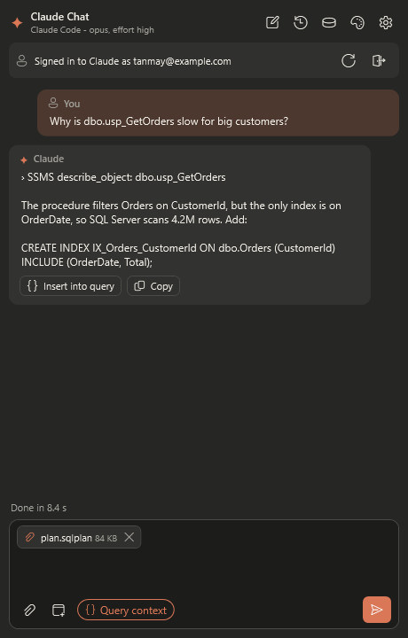
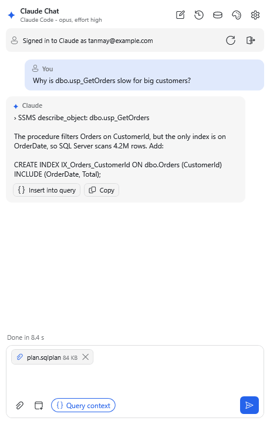

# ✦ SSMS Claude Chat: Claude AI for SQL Server Management Studio

**SSMS Claude Chat** is a free add-in that puts a Claude AI chat window inside **SQL Server Management Studio
(SSMS 21 and 22)**. Ask about your database in plain English, get stored procedures explained or written, fix slow
queries and draw database diagrams. Nothing in your database changes until you click **Yes**.

### [⬇ Download SSMS Claude Chat (free)](https://ssmsclaudechat.azurewebsites.net/)

[Website & help](https://tanmays0406.github.io/ssms-claude-chat/) ·
[How to install](https://tanmays0406.github.io/ssms-claude-chat/getting-started/) ·
[FAQ](https://tanmays0406.github.io/ssms-claude-chat/faq/) ·
[Report a problem](https://github.com/TanmayS0406/ssms-claude-chat/issues) ·
[♥ Sponsor](https://github.com/sponsors/TanmayS0406)

  
  

## What it does

- **Answers questions about your database:** "which tables hold customer data?", "what uses this column?"
- **Explains and writes stored procedures** in plain English.
- **Helps fix slow queries:** paste a query or attach an execution plan and ask why it's slow.
- **Draws diagrams:** database (ER) diagrams in one click, and flowcharts of procedures.
- **Asks before changing anything:** you see the exact SQL and where it will run, then click Yes or No.
- **Remembers your chats,** and takes attached files and screenshots.
- **Eight colour themes,** including dark mode and one that matches SSMS.

## Get started in 3 steps

1. [Download SSMS Claude Chat](https://ssmsclaudechat.azurewebsites.net/), close SSMS and run the setup.
2. In SSMS, click **View > SSMS Claude Chat**.
3. Click **Sign in**, sign in with your Claude account, and ask a question.

You need SSMS 21 or 22 on Windows, a Claude account and
[Claude Code](https://claude.com/claude-code). [Full install guide](https://tanmays0406.github.io/ssms-claude-chat/getting-started/).

## Help pages

| Page | |
| --- | --- |
| [How to install](https://tanmays0406.github.io/ssms-claude-chat/getting-started/) | What you need, install, sign in, first question |
| [What it does](https://tanmays0406.github.io/ssms-claude-chat/features/) | Everything SSMS Claude Chat can do |
| [Settings](https://tanmays0406.github.io/ssms-claude-chat/settings/) | Approvals for database changes, model, scripts folder |
| [Themes](https://tanmays0406.github.io/ssms-claude-chat/themes/) | Colour themes and accent colours |
| [FAQ](https://tanmays0406.github.io/ssms-claude-chat/faq/) | Cost, privacy, safety and fixes for common problems |

## About this repository

This is the public home of SSMS Claude Chat: the help website (GitHub Pages, from the `main` branch) and the
place to report problems or ask for features. To improve the help pages, edit the Markdown files and open a pull
request.

## Support the project

SSMS Claude Chat is free. If it saves you time, please consider [sponsoring](https://github.com/sponsors/TanmayS0406).

---

Not affiliated with Microsoft or Anthropic. Claude is a trademark of Anthropic, PBC; SQL Server and SSMS are
trademarks of Microsoft.
